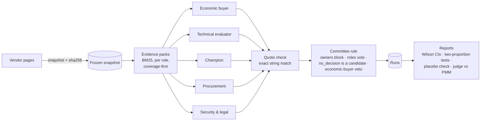

# Foil

**Put your website in front of a buying committee of AI agents. See who blocks the deal, and which sentence changes their mind.**

Foil simulates a B2B buying committee with five role agents (economic buyer, technical evaluator, champion, procurement, security & legal). Each agent reads a frozen copy of competing vendors' pages and judges every requirement, quoting the page. Code verifies every quote and code decides the deal. Every finding is repeated until it's statistically clear. Then you edit one paragraph and measure whether the committee moves.

**Live results:** [foil /lab](https://foil-seven.vercel.app/lab) · **Built by** [Aviv Braun](https://avivbraun.com/?utm_source=github&utm_medium=readme&utm_campaign=foil&utm_content=byline), product marketer

---

## The headline result

A Series B in Berlin choosing product analytics (PostHog, Mixpanel, Amplitude), with requirements owned by different committee members.

1. **On public pages alone, nobody wins.** 100% of 20 committees end in "no decision". What blocks every vendor is proof of two things: *works with our warehouse* and *predictable pricing*. That's a messaging gap, not a product gap.
2. **One paragraph flipped a stakeholder.** Adding a short warehouse-proof paragraph to PostHog's pricing page took the technical evaluator's block from **80% to 0%** (p < 0.001) and tripled committee support (1.0 → 3.1 of 5).
3. **Another paragraph backfired.** The pricing-proof paragraph made procurement *more* likely to block (70% → 94%, p = 0.05). The deal still stalls on one objection.
4. **The experiment is clean.** Vendors that weren't edited didn't move (placebo check).

Details: [docs/M4-RESULTS.md](docs/M4-RESULTS.md) · [docs/AB-POSTHOG-PROOF.md](docs/AB-POSTHOG-PROOF.md)

## Can you trust it? Evals

| What we measured | Result |
|---|---|
| AI judge vs. a PMM's answer key (30 items) | **87% agreement, κ 0.73** (keyword baseline: 77%, κ 0.37) |
| Same verdict across repeated runs | 90% of items |
| Quotes that exist verbatim on the page | Gemini 99% · gpt-oss-120b 89% |
| Agents contradicting their own verdicts | Gemini 2% · gpt-oss-120b 38% (p < 0.0001) |

Contradictions never change an outcome, because the decision is computed by code from per-requirement verdicts, not from what the model says it prefers.

Details: [docs/JUDGE-EVAL.md](docs/JUDGE-EVAL.md) · [docs/BASELINE-REPORT.md](docs/BASELINE-REPORT.md) · [docs/M2-RESULTS.md](docs/M2-RESULTS.md) · [docs/M3-RESULTS.md](docs/M3-RESULTS.md)

## How it works



1. **Freeze.** Every vendor page is captured once with a fingerprint. Every run reads identical text, so an edit is a controlled experiment.
2. **Retrieve.** Per-role evidence packs (BM25, coverage-first): each agent sees the passages relevant to what it owns. Same evidence for every model.
3. **Judge.** Each role agent rates every vendor on every requirement: met, not met or unclear, with a quote.
4. **Verify.** Every quote is string-matched against the full page. A "met" without a real quote is downgraded to "unclear".
5. **Decide.** By code: requirement owners block ("unclear" isn't good enough for the owner), roles vote, "no decision" is a candidate, and the economic buyer can veto. Because the rule is a pure function, stored runs can be re-scored for free when the rule changes. That happened once: v1 let a vendor "win" with 1 of 5 votes.
6. **Measure.** Repeated runs across two model families, Wilson intervals, two-proportion tests, a placebo check and a judge scored against a PMM.

## Engineering notes

- **$0 to run.** Gemini and Groq free tiers; Supabase and Vercel free plans. Prompts were cut from ~15K to ~3–4K tokens by evidence packs, which also made Groq's 8K tokens/minute limit workable.
- **Unattended experiments.** Supabase `pg_cron` calls a quota-safe batch endpoint every 5 minutes (agents one at a time, at most 2 tries, then back off) until each experiment hits its target. It survives hours of `503 high demand` from free-tier models.
- **Reproducible.** The served model version is recorded per call (aliases drift). Every number in `docs/` is regenerated from `data/` by a script.
- **Locked-down storage.** Working data lives in an isolated Postgres schema, reachable only through secret-checked `SECURITY DEFINER` functions.
- **Tested.** 30 unit tests: quote verification, retrieval coverage, committee rules, statistics (including a textbook κ case) and page variants.

## Repo layout

```
api/_lib/      agents, providers, evidence packs, citations, committee, stats, variants
api/dev/       experiment endpoints (disabled in production)
data/          exported runs and the PMM answer key
docs/          spec, milestone results, generated reports
scripts/       report generators (re-run to reproduce every number)
src/pages/Lab  the public results page
tests/         unit tests
```

## Reproduce the numbers

```bash
npm install
npm test
npx tsx scripts/report.ts data/baseline-v1.json docs/BASELINE-REPORT.md
npx tsx scripts/judge-report.ts data/judge-eval-v1.json docs/JUDGE-EVAL.md
npx tsx scripts/ab-report.ts data/ab-posthog-proof-v1.json docs/AB-POSTHOG-PROOF.md
npx tsx scripts/build-lab-data.ts
```

## Limits

- A rehearsal, not ground truth. Real buyers also read reviews, ask peers and talk to sales.
- One deal, three vendors, two pages each. Agents read text excerpts, not full sites.
- Free-tier models, about 20 runs per condition: only large effects reach significance.
- The edited copy in the experiment is hypothetical and says nothing about the vendors' actual products.
